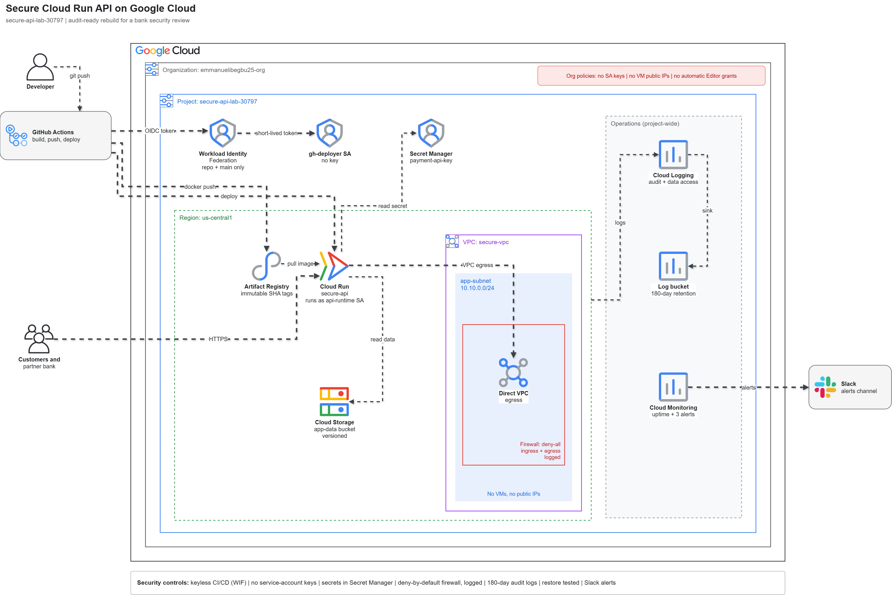

# Secure Cloud Run on GCP: audit-ready rebuild

[Mermaid version](docs/architecture.md)

## What this project is

A Terraform rebuild of a customer-facing fintech API on Google Cloud. The goal is to pass a partner bank security audit. Every control has a file in this repo as proof.

## GCP services used

- Cloud Run for the API
- VPC with Direct VPC egress, subnet flow logs, and deny-by-default firewall rules
- IAM with one service account per job and no service-account keys
- Workload Identity Federation for keyless GitHub Actions login
- Artifact Registry with immutable image tags
- Secret Manager for all secrets
- Cloud Storage with versioning and soft delete
- Cloud Logging and Cloud Audit Logs with a 180-day log bucket
- Cloud Monitoring with an uptime check and Slack alerts
- Terraform for all infrastructure and GitHub Actions for CI/CD

## What it includes

- Terraform for APIs, custom VPC, deny-by-default firewall, IAM, Artifact Registry, Secret Manager, Cloud Run, logging, monitoring
- Keyless CI/CD: GitHub Actions to Cloud Run through Workload Identity Federation
- Secrets in Secret Manager, no service-account keys
- Audit logs, VPC flow logs, 180-day log bucket
- Uptime check and Slack alerts for downtime, errors, latency
- Misconfiguration review with before and after proof
- Timed restore test
- Evidence pack, architecture diagram, runbook

## How it was built

1. Built an insecure baseline and ran the audit script to capture the "before" state.
2. Wrote the foundation in Terraform: remote state, providers, enabled APIs.
3. Added the custom VPC, flow logs, and deny-by-default firewall.
4. Added per-job service accounts and Workload Identity Federation.
5. Added Artifact Registry, Secret Manager, and a versioned data bucket.
6. Containerized the API and deployed it to Cloud Run.
7. Built the keyless GitHub Actions pipeline.
8. Turned on audit logs and the 180-day log bucket.
9. Added the uptime check and Slack alerts, then tested each alert.
10. Fixed the findings and ran the audit script again for the "after" state.
11. Ran and timed a restore test.
12. Wrote the evidence pack, diagram, and runbook.

Every step was committed to Git with a change log entry and undo steps.

## Result

- Findings and fixes with before and after proof: docs/findings.md
- Every control mapped to its proof: docs/evidence-pack.md
- Restore steps and timing: docs/restore-test.md
- Raw audit output: evidence/before and evidence/after

## Layout

- app/ API code and Dockerfile
- terraform/ infrastructure
- .github/workflows/ CI/CD
- scripts/ Terraform helper, save-to-GitHub script, security audit script
- docs/ evidence pack, findings, runbook, restore test, change log
- evidence/ before and after outputs, plans, screenshots

## Quick start

1. Run `gcloud auth login` and `gcloud auth application-default login`
2. Create the state bucket (docs/GCP-BUILD-GUIDE.md, Phase 4)
3. Run `cp terraform/terraform.tfvars.example terraform/terraform.tfvars` and fill it in
4. Run `cd terraform && terraform init && terraform apply`
5. Set the four GitHub Actions variables from terraform output
6. Push to main to deploy

## Docs

- docs/evidence-pack.md
- docs/architecture.md
- docs/runbook.md
- docs/findings.md
- docs/restore-test.md
- docs/CHANGELOG.md
- docs/week-01.md
